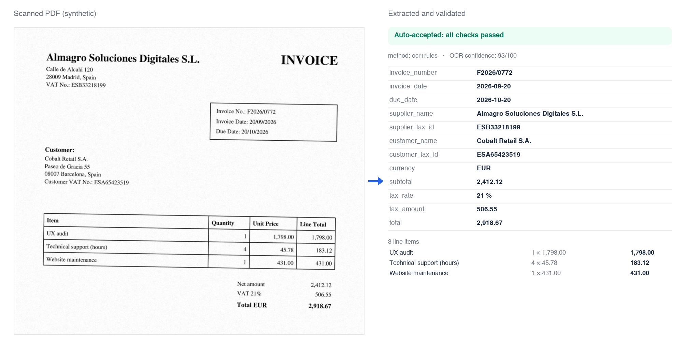
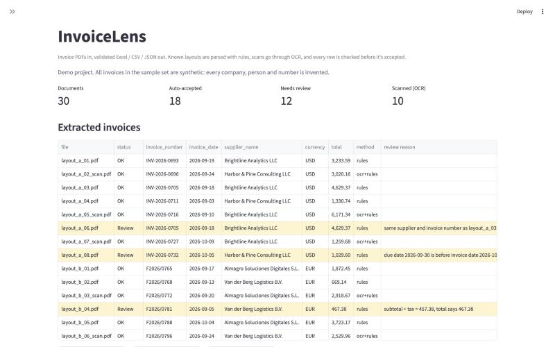
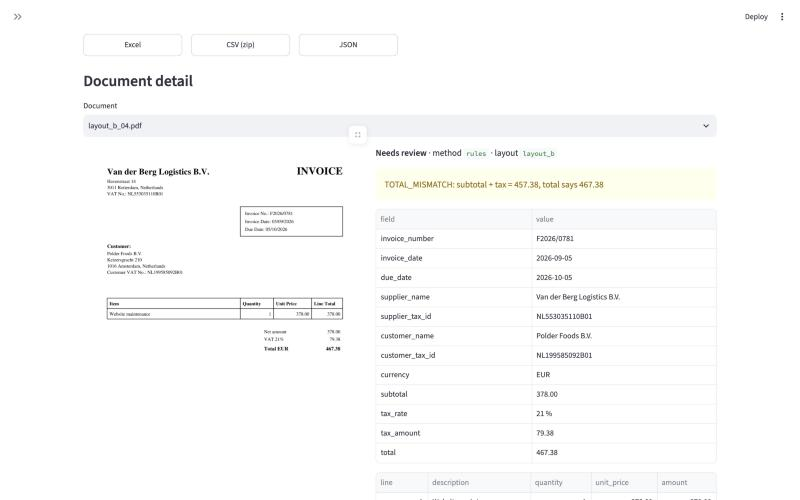
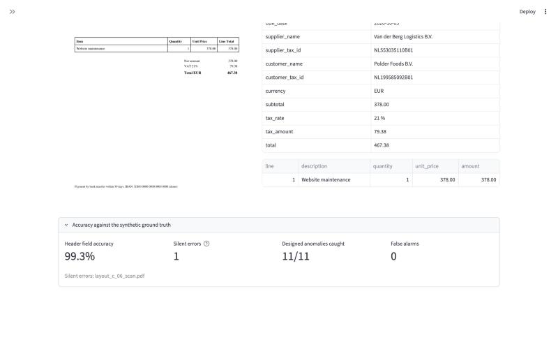

# InvoiceLens

**Demo project.** Turn a folder of invoice PDFs into a clean Excel, CSV or JSON file, and flag every invoice that needs a human look instead of guessing.

All test invoices are synthetic: every company, person, tax ID and amount was generated by [`synthetic/generate.py`](synthetic/generate.py). This is a personal portfolio project, not client work.



## What it does

1. **Reads the PDF.** Text-based PDFs are read from the text layer. Scanned pages go through OCR (Tesseract) after deskewing, denoising and removing table borders, which otherwise turn into garbage text.
2. **Recognises the layout.** Three known layouts are parsed with rules: fast, free and predictable.
3. **AI step for unknown layouts (optional, off by default).** Documents no rule set recognises are sent to Claude with a strict JSON schema, so the answer always has the same 12 fields plus line items.
4. **Validates every row**, whichever path produced it:
   - required fields present
   - line items × price = amount, and line items add up to the subtotal
   - tax % × subtotal = tax amount; subtotal + tax = total
   - due date not before invoice date
   - supplier and customer tax IDs: format and checksum (Spanish NIF/NIE/CIF, French and German VAT) or format (Dutch VAT, US EIN)
   - duplicate invoice (same supplier and number) within the batch
   - low OCR confidence
5. **Exports** an Excel file with a `needs_review` column and the reason, a line-items sheet and a summary, plus CSV and JSON.

Nothing is guessed: if a value can't be read or doesn't add up, the invoice is flagged with the reason.

## Results on the synthetic set

30 invoices: 4 layouts (3 with rules, 1 "unseen" letter-style layout with no rules), 10 scanned (one deliberately bad scan). Some invoices carry designed anomalies: a supplier arithmetic error, a duplicate, an invalid tax ID checksum and a due date before the issue date. Run `python -m invoicelens evaluate ...` to reproduce; the full per-document table is written to `output/evaluation.md`.

AI step **off**:

| Metric | Result |
|---|---|
| Header field accuracy (23 documents the rules could read) | 99.3 % |
| Auto-accepted (no flag) | 18 / 30 |
| Auto-accepted and fully correct (12 fields + every line item) | 17 / 18 |
| **Silent errors** (accepted but wrong) | **1**: an accent misread by OCR on a scanned invoice ("Lumiére" for "Lumière") |
| Designed anomalies caught | 5 / 5 (duplicate, date order, total mismatch, invalid tax ID, bad scan) |
| Unknown-layout documents routed to review | 6 / 6 |
| False alarms (flagged although correct) | 0 |
| Processing time | ~15 s for 30 documents on a laptop (OCR is most of it) |

One more scanned invoice was flagged because OCR misread its Dutch VAT number: the checksum and format checks caught it, so it went to review instead of into the data.

**What these numbers do and don't mean:** they are measured on 30 synthetic documents I generated, with layouts I wrote rules for. Real invoices are messier. With a client, the first step is always to run a sample of their real documents and report the accuracy on those.

## Known limitations

- OCR runs with Tesseract's English model only, so accented characters in other languages can be misread (the one silent error above). Installing the matching Tesseract language packs would address it.
- Rules cover three layouts. New suppliers with new layouts need either a new rule set for that layout or the AI step.
- The bad scan (heavy noise, 110 dpi) is not extracted at all. It is flagged for review, which is the intended behaviour.
- The AI step is covered by automated tests with a mocked API client (request shape, schema, refusal handling, validation of the AI output). Its accuracy on this set has not been measured yet, because that needs an API key and sends documents to the Anthropic API.
- Handwriting, photos taken with a phone and multi-page tables are out of scope for this demo.

## Run it

Requires Python 3.11+ and Tesseract (`brew install tesseract` on macOS, `apt install tesseract-ocr` on Debian/Ubuntu).

```bash
python -m venv .venv && source .venv/bin/activate
pip install -r requirements.txt

python synthetic/generate.py                       # creates samples/invoices + ground_truth.json
python -m invoicelens process samples/invoices --out output
python -m invoicelens evaluate samples/invoices --truth samples/ground_truth.json
streamlit run app.py                               # web demo
pytest -q
```

### Optional AI step

```bash
export ANTHROPIC_API_KEY=...                       # your own key
python -m invoicelens process samples/invoices --out output --ai
```

- Only documents that no rule set can read (or that come out with required fields missing) are sent.
- Model: `claude-opus-5-5` by default; set `INVOICELENS_MODEL` to use another one (for example a cheaper model for high volumes).
- Requests use structured outputs (strict JSON schema) and server-side fallback if the request is declined. AI answers go through the same validation as rule-based ones.
- It sends the PDF to the Anthropic API, so only enable it for documents you are allowed to share with a third-party processor.

## Project layout

```
invoicelens/
  text.py       PDF text layer, OCR and image clean-up (deskew, denoise, table-rule removal)
  layouts.py    layout detection and rule-based parsers
  ai.py         Claude fallback with a strict JSON schema
  validate.py   business checks and duplicate detection
  taxid.py      tax ID format and checksum validation
  pipeline.py   routing: text/OCR -> rules -> AI -> validation
  export.py     Excel / CSV / JSON
  evaluate.py   accuracy against ground truth ("silent errors" first)
app.py          Streamlit web demo
synthetic/      synthetic invoice generator
tests/          unit and end-to-end tests
docs/           screenshots and the before/after image script
```

## Screenshots

| Batch overview | Flagged invoice | Accuracy |
|---|---|---|
|  |  |  |
